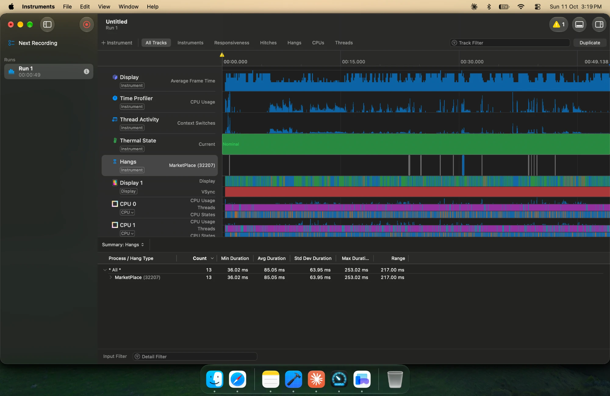

# MarketPlace

An offline-first marketplace app for iOS. Browse listings, mark favorites, and create or edit your own listings with photos, even without a network. Changes sync when the app is online again.

## Demo video

[Watch the 3-minute demo (Google Drive)](https://drive.google.com/file/d/1jLT2Mp6afPrCbjC700qgy40ABoaVGpjT/view?usp=share_link)

## Features

- Browse about 200 listings, search by title, open details with a photo gallery.
- Favorites (stored on the device only).
- Create and edit your own listings: title, description, price in ₹, category, up to 3 photos from the camera or photo library.
- Works offline. New and edited listings are saved locally first and marked "Pending".
- Syncs on launch, when the app comes to the foreground, when the network comes back, after saving, on pull to refresh, and in background app refresh.
- Sync status bar (Offline, Syncing, Up to date, Failed + Retry) and a badge on each unsynced listing.
- Conflict handling: last write wins, decided by the server with `updatedAt` property.

## Requirements

- iOS 17.0 or newer (iPhone).
- A recent Xcode. The project uses Xcode's newer project format, so older versions may not open it.
- No third-party packages.

> Built and tested with Xcode 27.1 RC on macOS 27.0.1.

## Run

1. Open `MarketPlace.xcodeproj`.
2. Pick the `MarketPlace` scheme and an iPhone simulator.
3. Run.

The backend is a mock server inside the app (mentioned below), so there is nothing else to start.

## Tests and lint

- SwiftLint is installed on the Mac with `brew install swiftlint`.
- Run from the terminal: `swiftlint lint --strict`.
- SwiftLint also runs as an Xcode build phase, so issues show inline while coding (user script sandboxing is off for the app target so the script can read the sources).
- 5 unit tests in `MarketPlaceTests/SyncEngineTests.swift`, all for sync logic:
  - offline keeps a listing pending and sends nothing
  - a new listing is POSTed and marked synced
  - a server error keeps the listing pending (not failed)
  - a conflict (409) applies the server's newer copy
  - pulling server changes doesn't overwrite a pending local edit
- The tests use a fake API, a fake network monitor and an in-memory database.
- CI (`.github/workflows/ci.yml`) runs lint, build and tests on every push and pull request.

## How it works

- Layers: SwiftUI views and view models → repository and sync engine → SwiftData, image files, API client. Details and diagrams are in [docs/ARCHITECTURE.md](docs/ARCHITECTURE.md).
- The local database (SwiftData) is the source of truth. The UI always reads from it.
- Every user change is saved locally first with `syncState = pending`. Pending rows are the upload queue.
- Sync pushes pending listings (photos first, then the listing), then pulls server changes since the last known revision.
- Create vs update: a listing with no server `revision` is POSTed, otherwise PUT.
- Conflicts: the app sends its `updatedAt`. If the server has a newer copy, it returns 409 with that copy and the app uses it.
- Temporary errors (offline, 5xx, 401) keep listings pending for the next sync. Validation errors (422) mark the listing "Failed" with the server's message, until the user edits it.

## Mock server

- `MockServer` runs inside the app. `MockURLProtocol` routes every request for `https://mock.marketplace.local` to it. Nothing goes over the network.
- The API client (`HTTPListingsAPI`) is normal `URLSession` code. To use a real backend, remove `MockURLProtocol` from the session and change the host.
- Seeds 200 listings from 20 sellers on first launch. Their photos are drawn on request (a colored square with the category name).
- Saves its state to `Application Support/MockServer/`, so data and revisions survive relaunches.
- Each request waits 300 ms (image downloads don't), so "Syncing…" is visible.
- The auth token is a development token from `GET /auth/token`. It's stored in the Keychain.

## Trying offline mode

- The Simulator uses your Mac's network. Turn off the Mac's Wi-Fi.
- The status bar shows "Offline". Create or edit a listing: it shows "Pending".
- Turn Wi-Fi back on. The app syncs.
- Note: the mock server is inside the app, so requests don't fail while offline. The app checks `NWPathMonitor` and doesn't sync while offline.

## Background sync

- Uses SwiftUI `.backgroundTask(.appRefresh(...))`. A refresh is requested when the app goes to the background with pending listings. iOS decides if and when it runs. Foreground sync is the main path.
-  A background `URLSession` could be another option, but it can't be used here because the mock server runs inside the app.
- In the Simulator, scheduling fails with `BGTaskSchedulerErrorDomain` error 1 (unavailable), so the app logs it and relies on foreground sync there; background refresh must be tested on a device.

## Performance: memory and CPU

What the code does:

- Photos are downsampled to max 1600 px (JPEG 0.8) before saving or uploading. A 12 MP photo is never stored at full size.
- Downsampling uses ImageIO thumbnails, so the full-size bitmap is never decoded into memory.
- List rows show a thumbnail decoded at the exact display size (60 pt × screen scale), not the full photo.
- Decoded thumbnails live in an `NSCache` with a 40 MB cost limit. iOS can empty it under memory pressure.
- Downloaded images are cached on disk (`Caches/RemoteImages`), so each image is downloaded once.
- Image loading and decoding happen in actors, off the main thread. Loads are cancelled when a row scrolls away (`.task(id:)`).
- `List` only creates visible rows. The price formatter is created once.

Measured in the Simulator (iPhone 16 Pro, iOS 18.6):

| What | Result |
|---|---|
| Memory after launch, first screen of rows shown | 37 MB |
| Memory after fast scrolling to the end of the list and back | 47 MB (peak 49 MB) |
| Disk cache after all 200 seeded images loaded (`Caches/RemoteImages`) | 2.6 MB |
| Saved photo size (max 1600 px, JPEG 0.8) | 1600×1200 ≈ 0.9 MB, 1600×1068 ≈ 0.5 MB |

Instruments recording in the Simulator (Time Profiler and Hangs):

- Image downsampling runs on background threads (`ImageLoader` actor), not on the main thread.
- Repository work on the main thread (`ListingRepository`): about 250 ms in total over the session.
- Memory stays flat while scrolling, because rows reuse cached thumbnails.
- The Simulator runs on the Mac's CPU, so real-device numbers may differ.

## Known limits

- No delete listing functionality.
- Favorites are local only.
- Search is by title only.
- No paging.
- Last write wins uses the device clock. A wrong clock can pick the wrong winner. A real server would use server time or version numbers.
- The 200 seeded listings are pulled and saved on the main actor in one batch. A much larger first sync should be moved to a background context with `ModelContext and ModelActor`
- Background upload uses app refresh, not a background `URLSession` (which can't use an in-app mock).
- Tests cover the main sync rules only (5 tests).

## What can be done next

- Real backend and real authentication.
- Favorites are local only currently, can be synced with server using API if needed.
- Background `URLSession` for photo uploads.
- Paging for the listing feed.
- Delete a listing functionality.
- More Unit tests and UI tests.

## Docs

- [docs/ARCHITECTURE.md](docs/ARCHITECTURE.md): layers, diagrams, key decisions.
- [docs/ENGINEERING_STANDARDS.md](docs/ENGINEERING_STANDARDS.md): code style and rules used in this project.
