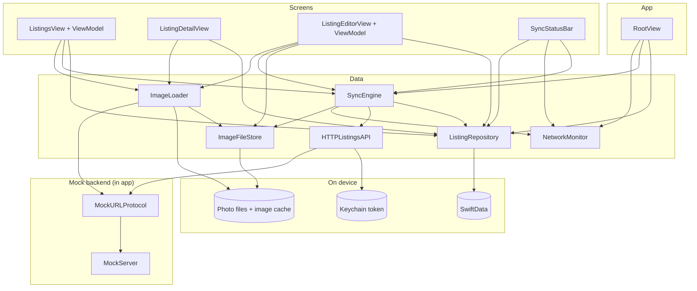
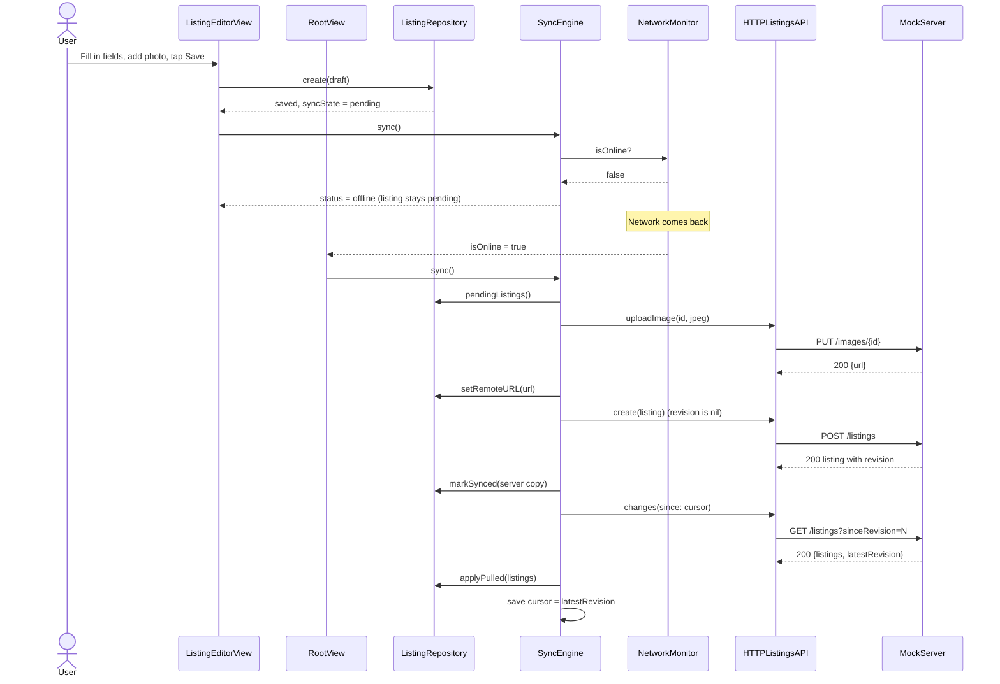
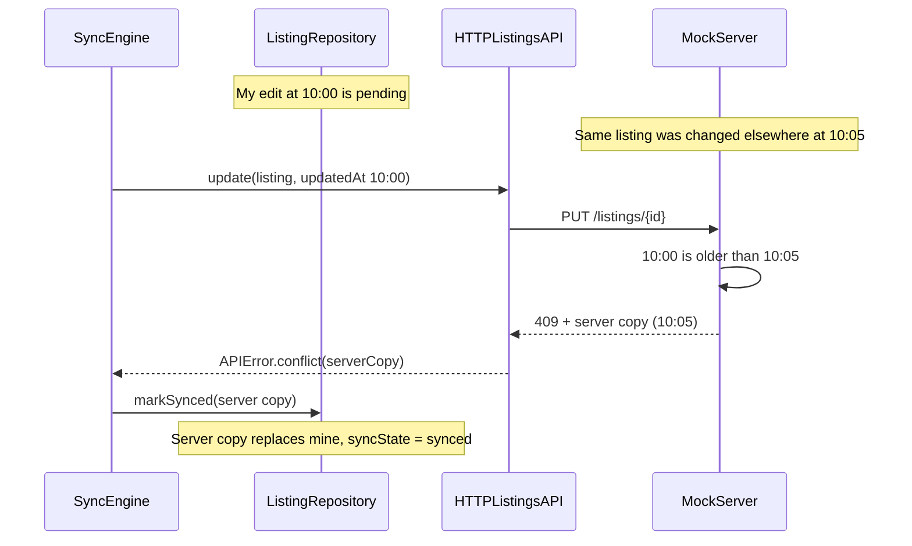

# Architecture

## Layers

| Layer | Folder | What's in it |
|---|---|---|
| App | `App/` | App entry, creates the shared objects, sync triggers, background task |
| Features | `Features/` | Screens and their view models |
| Shared | `Shared/` | Small views used in several places (thumbnail, status bar, badge), formatters, logging |
| Domain | `Domain/` | Plain models (`Listing`, `ListingDraft`, ...) and `ListingValidator`. Foundation only |
| Data / Local | `Data/Local/` | SwiftData model, `ListingRepository`, `ImageFileStore`. The only folder that imports SwiftData |
| Data / Remote | `Data/Remote/` | `ListingsAPI`, `HTTPListingsAPI`, DTOs, Keychain, mock server |
| Data / Sync | `Data/Sync/` | `SyncEngine`, `NetworkMonitor` |
| Data / Images | `Data/Images/` | `ImageDownsampler`, `ImageLoader` |

Rules:

- Views don't use SwiftData or `URLSession` directly. They go through the repository, the sync engine and the image loader.
- `ListingRepository` is the only type that reads and writes listings. It returns `Listing` structs, never SwiftData objects.
- Dependencies are passed in, so tests can replace them.
- Protocols only where tests need a fake `ListingsAPI` and `Connectivity`.

## Diagram

## Sequence: create a listing offline, then sync

## Sequence: conflict (last write wins)

## Sync rules

- Listings with `syncState == .pending` are the queue, oldest first.
- Photos are uploaded first, then the listing, so the listing is sent with photo URLs.
- No `revision` means POST, otherwise PUT. 
- `updatedAt` only changes on user edits. Favorites and syncing don't touch it.
- `markSynced` and `markFailed` only change the state if `updatedAt` is still what we pushed. If the user edited during the push, the newer edit stays pending.
- A pull never overwrites a pending or failed listing. It keeps the local favorite and local photo files.
-  Temporary errors (offline, 5xx, 401, bad JSON) stop the sync and keep listings pending.
- Only one sync runs at a time. If another is asked for during a sync, it runs once more after.
- On the server, a POST with an existing id works like a PUT, so a retry can't create a duplicate.

## Concurrency

| Type | Runs on |
|---|---|
| Views, view models, `ListingRepository`, `SyncEngine`, `NetworkMonitor` | Main actor |
| `ImageFileStore`, `ImageLoader` | Their own actors, off the main thread |
| `MockServer` | Any thread, with its data behind one lock |
| Network calls | `URLSession` with async/await |

- Swift 5 with strict concurrency checking set to complete. 
- No `DispatchQueue.main.async`, no `Task.detached`, no `@unchecked Sendable`.

## Decisions and trade-offs

| Decision | Why | Trade-off |
|---|---|---|
| SwiftData behind a repository | Built into iOS and simple. Views never see the database. | Needs iOS 17+ |
| Pending listings are the queue | One source of truth that survives app restarts | No separate retry schedule |
| Last write wins, decided by the server | Simple to build | A wrong device clock can pick the wrong winner |
| Revision | Only changed listings are downloaded | The server has to keep a global counter |
| Mock server through `URLProtocol` | The real HTTP code | Going offline doesn't make requests fail on its own |
| `NSCache` plus the Caches folder for images | Memory stays limited and each image downloads once | If iOS clears the cache, images download again |
| Background app refresh | Simple SwiftUI API | iOS decides when it runs |
|  |
