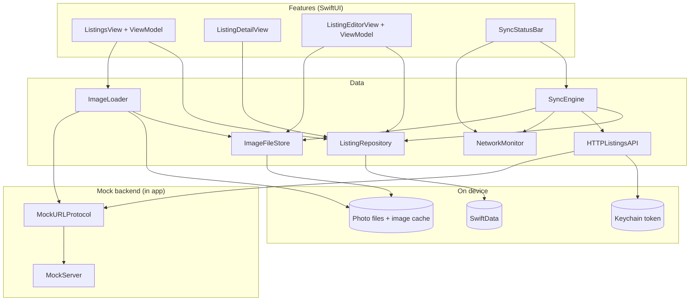
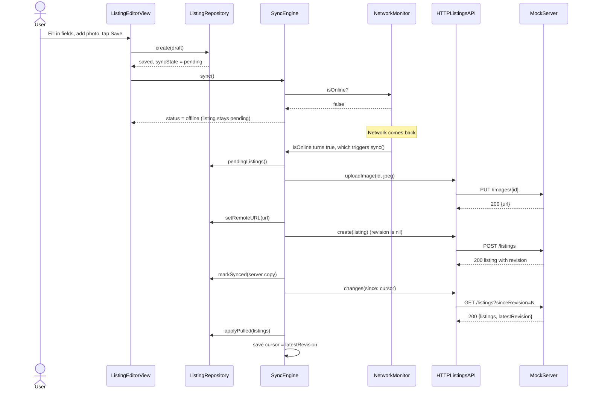
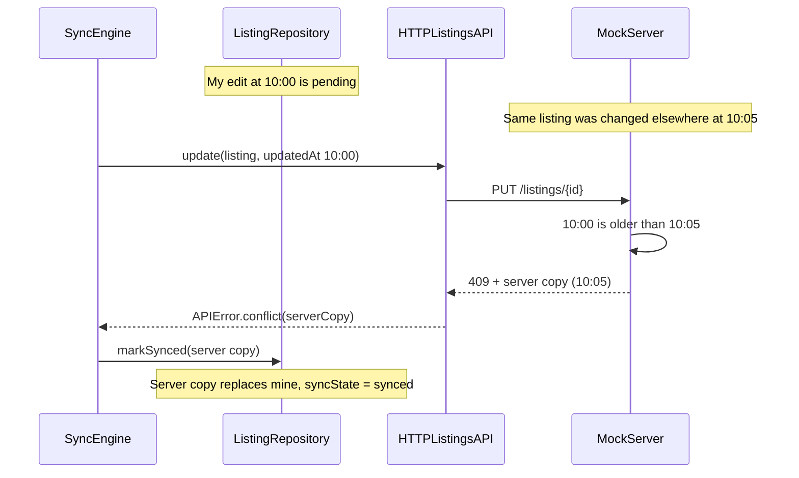

# Architecture

## Layers

| Layer | Folder | What it does |
|---|---|---|
| App | `App/` | Creates the shared objects, injects them, sync triggers, background task |
| Features | `Features/` | SwiftUI screens and their view models |
| Shared | `Shared/` | Small reusable views (thumbnail, status bar, badge), formatters, logging |
| Domain | `Domain/` | Plain models (`Listing`, `ListingDraft`, ...) and `ListingValidator`. Foundation only |
| Data / Local | `Data/Local/` | SwiftData model, `ListingRepository`, `ImageFileStore`. The only place that imports SwiftData |
| Data / Remote | `Data/Remote/` | `ListingsAPI` protocol, `HTTPListingsAPI`, DTOs, Keychain, mock server |
| Data / Sync | `Data/Sync/` | `SyncEngine`, `NetworkMonitor` |
| Data / Images | `Data/Images/` | `ImageDownsampler`, `ImageLoader` |

Rules:

- Views read state and forward user actions. No storage or network calls in views.
- `ListingRepository` is the only type that reads or writes listings. It returns `Listing` structs, never SwiftData objects.
- Dependencies are passed in (`init` or SwiftUI environment), so tests can swap them.
- Protocols only where tests need a fake: `ListingsAPI` and `Connectivity`.

## Diagram

## Sequence: create a listing offline, then sync

## Sequence: conflict (last write wins)

## Sync rules

- The queue is the listings with `syncState == .pending`, oldest first.
- Push photos first, then the listing, so the listing is sent with photo URLs.
- `revision == nil` → POST, else PUT. No extra "isNew" flag.
- `updatedAt` changes only on user edits. Favorites and sync don't change it.
- `markSynced` / `markFailed` only change state if `updatedAt` is still the pushed value. If the user edited during the push, the newer edit stays pending.
- Pull never overwrites a pending or failed local listing. It keeps the local favorite flag and local photo files.
- The pull cursor (`lastPulledRevision`) moves only after pulled data is saved.
- Temporary errors (offline, 5xx, 401, bad JSON) stop the run and keep listings pending. 422 / other 4xx mark only that listing failed.
- Only one sync runs at a time. A sync requested during a run causes one more round.
- Server: POST with an existing id acts like PUT, so retries can't create duplicates.

## Concurrency

| Type | Runs on |
|---|---|
| Views, view models, `ListingRepository`, `SyncEngine`, `NetworkMonitor` | Main actor |
| `ImageFileStore`, `ImageLoader` | Their own actors (off the main thread) |
| `MockServer` | Any thread; state behind one lock |
| Network calls | `URLSession` (async/await) |

- Swift 5 mode with strict concurrency checking set to complete, and warnings treated as errors.
- No `DispatchQueue.main.async`, no `Task.detached`, no `@unchecked Sendable`.

## Key decisions and trade-offs

| Decision | Why | Trade-off |
|---|---|---|
| SwiftData behind a repository | Native, simple; views never see the database | iOS 17+ only |
| Pending rows as the queue | One source of truth, survives app restarts | No separate retry schedule |
| Server-decided last write wins | Simple to explain and implement | Device clock skew can pick the wrong winner |
| Revision cursor for pull | Only changed listings are downloaded | Server must keep a global counter |
| Mock server via `URLProtocol` | Real HTTP code runs; no external server needed | Offline doesn't make requests fail by itself |
| `NSCache` + disk cache for images | Bounded memory, each image downloaded once | Cache can be cleared by iOS, then it re-downloads |
| App refresh for background sync | Simple SwiftUI API | iOS decides when it runs |
| One fixed currency (INR), price in paise as `Int` | No rounding errors, no currency field | Not multi-currency |
